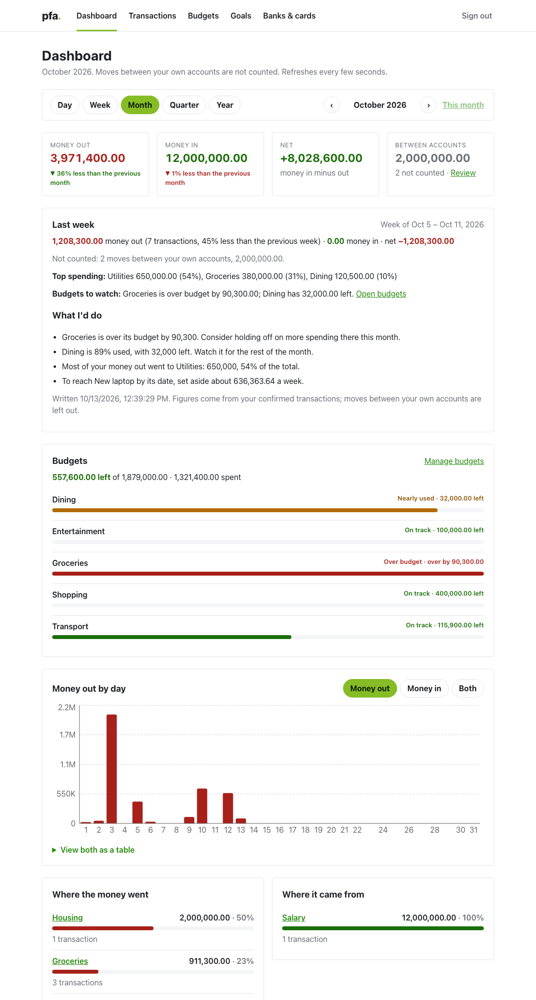
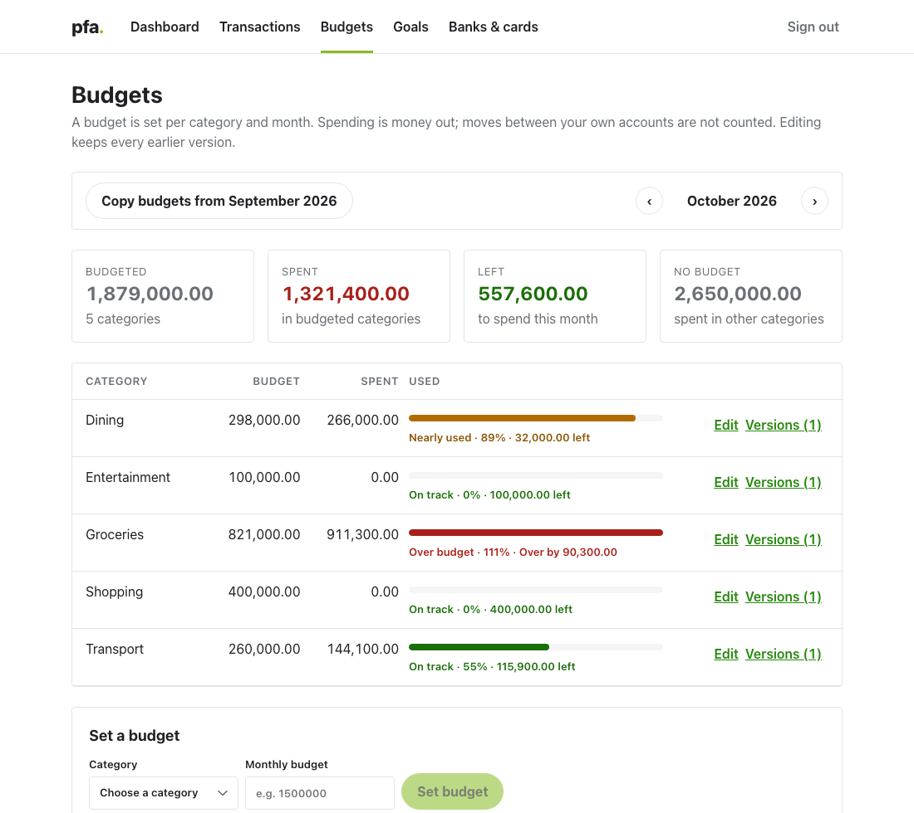
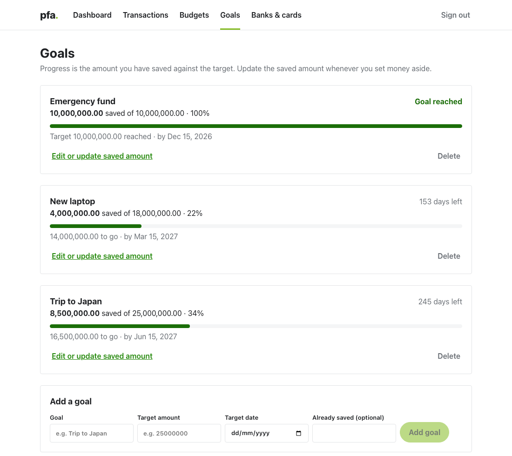
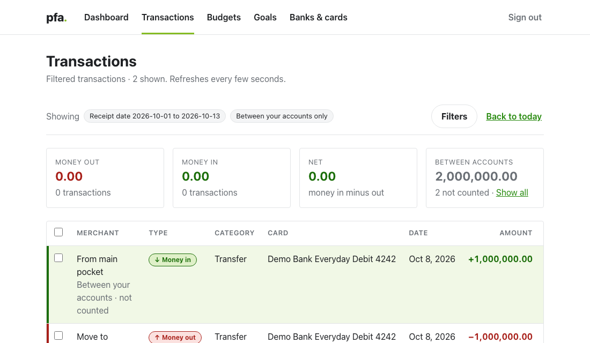
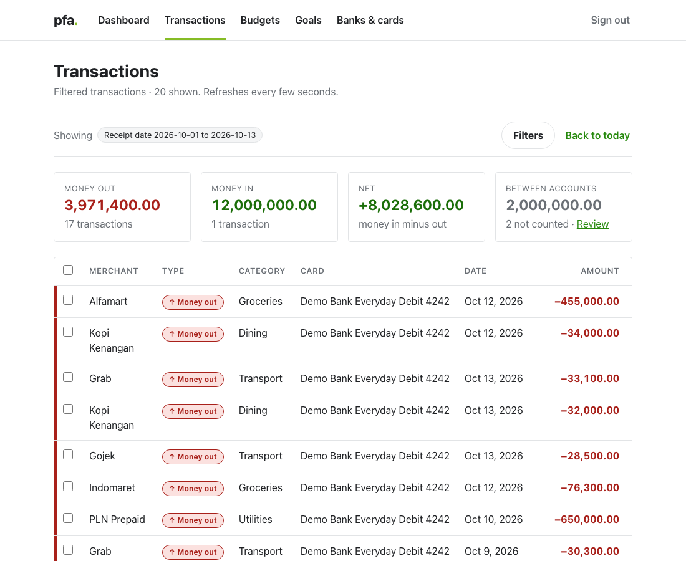

# pfa — a personal finance assistant that lives in Telegram

Send pfa a photo of a receipt or a bank statement. It reads it, asks you to confirm, and
turns it into a clear picture of where your money goes: a dashboard, budgets, savings
goals, nudges to log purchases, and a short summary every Monday.

Built for [Devpost's *Build With AI: Basics*](https://devpost.com/). Everything runs
locally; there is no hosted service and no bank connection.



*Fictional sample data, loaded with `pfa seed-demo`.*

## Who it's for

One person who wants to understand their own spending without spreadsheets or a bank
integration: someone who already lives in a chat app and would rather snap a receipt
than fill in a form. pfa is single-user by design: it only answers the one Telegram chat
you configure.

## What it does

- **Reads receipts and statements.** Send a receipt photo, or a statement as PDF, CSV or
  Excel. Gemini extracts the merchant, amount, date, category and card. Anything it
  cannot read is handed back to you, never guessed. Nothing is saved until you confirm.
- **Keeps money in and money out apart**, and leaves moves between your own accounts and
  pockets out of both totals, so paying a credit card bill never counts twice.
- **Dashboard** by day, week, month, quarter or year, compared with the period before,
  with a category breakdown and a chart. Every category links to its transactions.
- **Budgets** per category and month. Editing keeps every earlier version, and a button
  copies last month's budgets forward.
- **Savings goals** with progress and the pace you need to reach them.
- **Speaks up on its own.** It nudges you at the times you usually spend, and sends a
  short summary with advice every Monday.
- **Answers questions in chat**, such as "how am I doing on dining this week?", with the
  figures laid out line by line, and "what is 15% of 2,000,000?".

| | |
|---|---|
|  |  |
|  |  |

### A weekly summary in Telegram

This is the actual message pfa sends (the figures come from the demo data):

```text
Week of Oct 5 – Oct 11, 2026

Money out: 1,208,300 (7 transactions)
Money in: 0
Net: -1,208,300
Between your own accounts (not counted): 2 moves, 2,000,000

Top spending: Utilities 650,000 (54%), Groceries 380,000 (31%), Dining 120,500 (10%)

Budgets to watch: Groceries over budget by 90,300; Dining 32,000 left

What I'd do:
- Groceries is over its budget by 90,300. Consider holding off on more spending there this month.
- Dining is 89% used, with 32,000 left. Watch it for the rest of the month.
- Most of your money out went to Utilities: 650,000, 54% of the total.
- To reach New laptop by its date, set aside about 636,363.64 a week.

Full summary (sign-in link, valid for 10 minutes, works once): http://localhost:5173/auth?token=…
```

## The one design rule: the model never supplies a number

An AI that is asked about money will happily produce a confident wrong figure. So in pfa:

1. **Every figure is computed in code**, from your confirmed transactions, by SQL and plain
   Python: totals, percentages, shares, budget remaining, goal pace.
2. **The model only writes sentences**, from a block of facts it is shown. It never sees
   the database.
3. **Any arithmetic goes through a calculator tool** (real tool calling). The calculator is
   exact, runs no code, and only accepts numbers that are in your facts or your question.
4. **Every reply is checked.** A figure in a reply must be a fact, a number you wrote, or a
   calculator result. Otherwise the reply is discarded and pfa sends the plain figures, or
   a template, instead. A summary therefore always goes out, and is always true.

## How it works

```text
 Telegram  <──────────>  FastAPI process  <──────────>  Postgres
 (your chat)             ├─ Telegram bot (polling)       transactions, budgets,
                         ├─ scheduler (nudges, Monday)    goals, summaries,
                         └─ REST API  <────  React web app   LangGraph checkpoints
                              │
                              └─ LangGraph graphs ──> Gemini
                                   extraction  (Pro: receipts, statements)
                                   chat        (Flash Lite: conversation, insights)
                                   recommend   (Flash Lite: weekly advice)
```

- **Backend:** Python 3.12, FastAPI, SQLAlchemy 2 (async) with Alembic, python-telegram-bot,
  APScheduler. One process runs the API, the bot and the scheduler.
- **AI:** LangGraph and LangChain with Google Gemini. Extraction pauses for your
  confirmation using LangGraph's `interrupt`. Traces can go to LangSmith (off by default,
  and receipt images are always masked).
- **Web:** Vite, React 19, TypeScript, TanStack Query, Recharts.
- **Sign-in:** a single-use link sent to your Telegram chat (a short-lived signed token),
  then a session cookie. No passwords.

## Try it yourself

You need: **Docker**, **[uv](https://docs.astral.sh/uv/)** (it installs Python 3.12 for
you), **Node 20.19+ or 22.12+**, a Telegram account, and a free Gemini API key.

**1. Install**

```bash
git clone <this repo> && cd <repo folder>
uv sync                 # Python dependencies
cd web && npm ci && cd ..   # web dependencies
```

**2. Create your Telegram bot** (1 minute)

Open Telegram, message [@BotFather](https://t.me/BotFather), send `/newbot`, pick a name
and a username, and copy the **token** it gives you.

**3. Get a Gemini API key** (1 minute)

Create one at <https://aistudio.google.com/apikey>.

**4. Configure**

```bash
cp .env.example .env
```

Open `.env` and set `TELEGRAM_BOT_TOKEN`, `GEMINI_API_KEY` and `AUTH_SECRET`. Make a secret with:

```bash
python -c "import secrets; print(secrets.token_urlsafe(48))"
```

Leave `TELEGRAM_CHAT_ID=0` for now. `.env` is git-ignored.

**5. Start the database and create the tables**

```bash
docker compose up -d --wait db      # waits until Postgres is ready
uv run --env-file .env alembic upgrade head
```

**6. Find your chat id**

Open your new bot in Telegram and press **Start** (or send "hi"), then run:

```bash
uv run --env-file .env pfa chat-id
```

Copy the line it prints (`TELEGRAM_CHAT_ID=…`) into `.env`.

**7. Check everything** — this tells you exactly what is wrong, and how to fix it:

```bash
uv run --env-file .env pfa doctor
```

**8. (Optional) Load fictional sample data**, to see a full dashboard straight away. It
refuses to touch a database that already has data:

```bash
uv run --env-file .env pfa seed-demo
```

**9. Run it**

```bash
uv run --env-file .env uvicorn pfa.main:app      # terminal 1: API, bot and scheduler
cd web && npm run dev                            # terminal 2: web app
```

Open <http://localhost:5173>. It asks you to sign in: send `/login` to your bot in Telegram
and tap the link. (Telegram only makes links tappable when they have a public domain, so on
`localhost` you may need to copy the link into your browser.)

> No Make? `make help` lists shortcuts for all of the above, but nothing needs it.

### Things to try

- Send **`examples/receipt.png`** to the bot (as a photo or a file). Check what it read,
  fix anything, and tap **Confirm**. You get a sign-in link to see it in the web app.
- Send **`examples/statement.csv`**. pfa summarises it (count, total, highest, lowest), lists
  moves between your own accounts apart, skips duplicates, and saves it on one tap.
- Ask: *"how am I doing on dining this month?"*, *"what's my average spending per day?"*,
  *"what is 15% of 2,000,000?"*
- In the web app, tick transactions and use the bar at the bottom to change their category,
  mark them as money in or out, or flag them as a move between your own accounts.
- Open **Budgets**, edit one, and open **Versions** to see the earlier amount is kept.

### Telegram commands

| Command | What it does |
|---|---|
| `/login` | Sends a fresh single-use sign-in link for the web app |
| `/signout` | Ends every web session and cancels unused links |
| `/demo_summary` | Writes and sends the weekly summary right now |
| `/demo_nudge` | Sends a nudge right now |

Send a receipt or statement any time. There is no menu: just talk to it.

## Configuration

All settings are environment variables; `.env.example` lists them with comments.

| Variable | Meaning | Default |
|---|---|---|
| `TELEGRAM_BOT_TOKEN` | Token from @BotFather | (required) |
| `TELEGRAM_CHAT_ID` | The one chat pfa answers (`pfa chat-id` finds it) | (required) |
| `GEMINI_API_KEY` | Google AI Studio key | (required) |
| `AUTH_SECRET` | Signs sign-in links and sessions, 32+ random characters | (required) |
| `DATABASE_URL` | Postgres connection | the compose database on port 5433 |
| `GEMINI_CHAT_MODEL` / `GEMINI_EXTRACT_MODEL` | Models for chat and for reading uploads | `gemini-flash-lite-latest` / `gemini-pro-latest` |
| `TIMEZONE` | Used for "today", nudge times and the Monday summary | `Asia/Jakarta` |
| `SUMMARY_HOUR` | Hour (0-23) of the Monday summary | `8` |
| `WEB_BASE_URL` | Where sign-in links point | `http://localhost:5173` |
| `AUTH_LINK_TTL_MINUTES` / `AUTH_SESSION_DAYS` | Link and session lifetime | `10` / `7` |
| `CATEGORIES_FILE` | The category list (edit `config/categories.json`) | `config/categories.json` |
| `LANGSMITH_TRACING` | Send traces to LangSmith (includes your messages) | `false` |

## Privacy and safety

- **Receipts and statements are never written to disk.** They are held in memory while
  they are read and then dropped.
- **Gemini sees what you send it.** Receipt images and extracted text go to Google's API;
  nothing else leaves your machine. LangSmith tracing is off by default, and when it is on,
  images, PDFs and statement contents are masked before upload.
- **Only your chat is answered.** Messages from any other Telegram chat are ignored.
- **Sign-in links** are single use, expire after 10 minutes, and cannot be used as sessions.
  You get a Telegram message whenever one is used, and `/signout` ends everything.
- **Only confirmed data counts.** Anything extracted stays pending until you confirm it.

## Development

```bash
docker compose up -d db                   # tests need Postgres; they create their own database
uv run --env-file .env.example pytest     # the placeholders in .env.example are enough
uv run ruff check . && uv run black --check .
cd web && npm run build && npm run lint
```

Tests use a separate `pfa_test` database, fake Gemini models and a fake HTTP server, so
they never call Telegram or Google and need no real credentials.

```text
src/pfa/
  api/          FastAPI routes
  bot/          Telegram handlers, message formatting, nudges and summaries
  core/         settings, logging, tracing, errors
  graphs/       LangGraph: extraction, chat, recommendations, model wrappers
  models/       database tables
  repository/   database access, one class per aggregate
  schemas/      Pydantic models
  services/     business logic: analytics, budgets, insights, calculator, sign-in
  migrations/   Alembic
  cli.py        `pfa doctor`, `pfa chat-id`, `pfa seed-demo`
web/            the React app
tests/          pytest
config/         the category list
examples/       a sample receipt and statement
devpost/        the PRD, spec and build checklist
```

The thinking behind the build is in [`devpost/prd.md`](devpost/prd.md) (what and why),
[`devpost/spec.md`](devpost/spec.md) (how) and [`devpost/checklist.md`](devpost/checklist.md)
(the order it was built in, and every change of direction along the way).

## Troubleshooting

| Problem | What to do |
|---|---|
| Anything at all | `uv run --env-file .env pfa doctor` checks your settings, database, Telegram and Gemini |
| The bot does not answer | `TELEGRAM_CHAT_ID` is probably wrong or still `0`. Run `pfa chat-id` |
| `pfa chat-id` says the messages are being received elsewhere | Stop the app first (it polls Telegram), run it again, then restart the app |
| "Cannot connect to the database" | `docker compose up -d db`, then wait a few seconds. Port 5433 busy? Change it in `docker-compose.yml` and `DATABASE_URL` |
| The web app says to sign in | Send `/login` to your bot. Links last 10 minutes and work once |
| A model name is rejected | Set `GEMINI_CHAT_MODEL` and `GEMINI_EXTRACT_MODEL` to models your key can use (`pfa doctor` checks them) |
| `pfa seed-demo` refuses | The database already has data. For a clean one: `docker compose down -v`, then start the database and migrate again |
| Tests are skipped | Postgres is not running: `docker compose up -d db` |

## Limits

pfa is a proof of concept: one user, local only, no bank feed. The nudge and Monday jobs
live in the app's memory, so they only fire while it is running. A spreadsheet
statement can be up to 10 MB and 500 rows.
